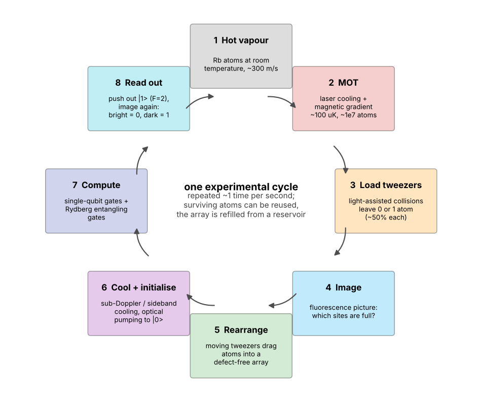
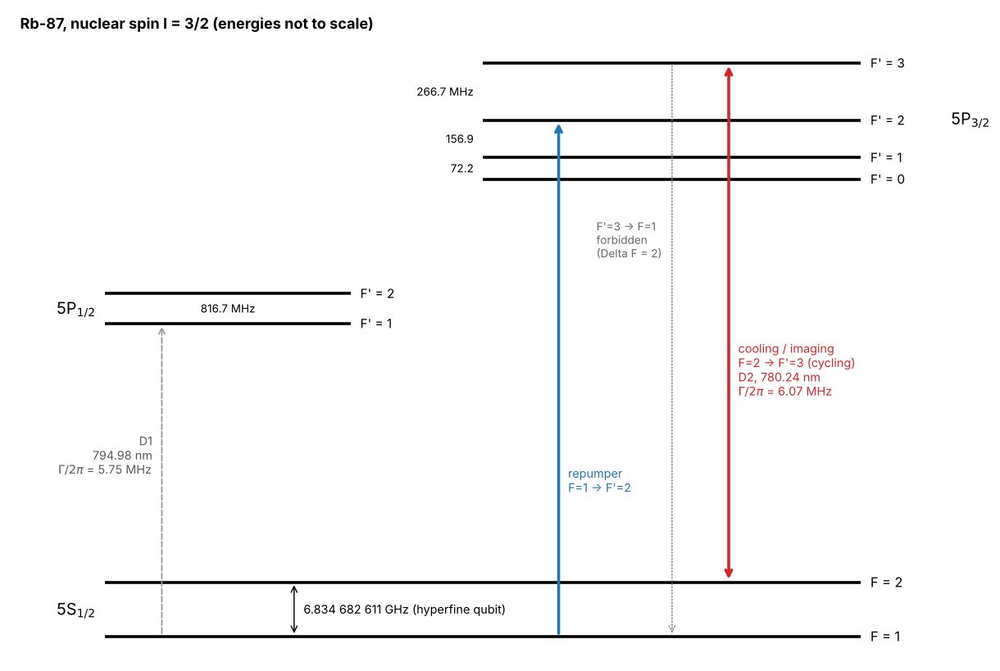
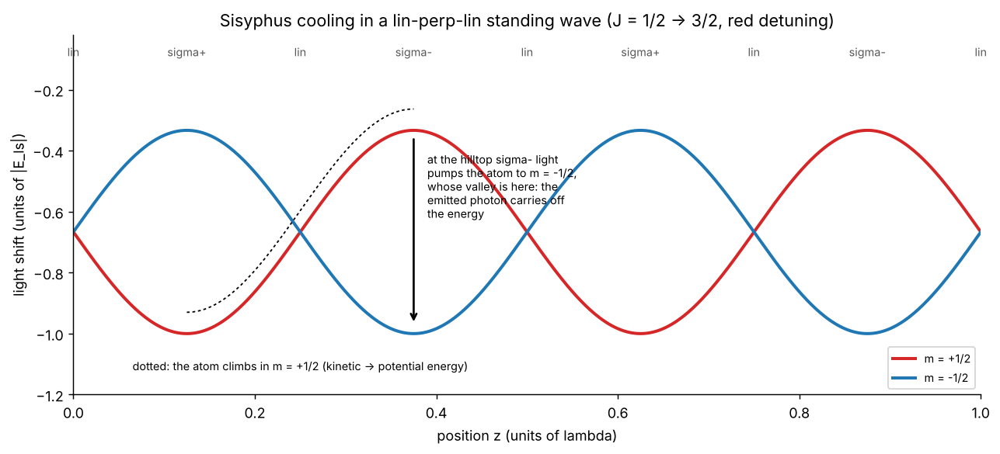
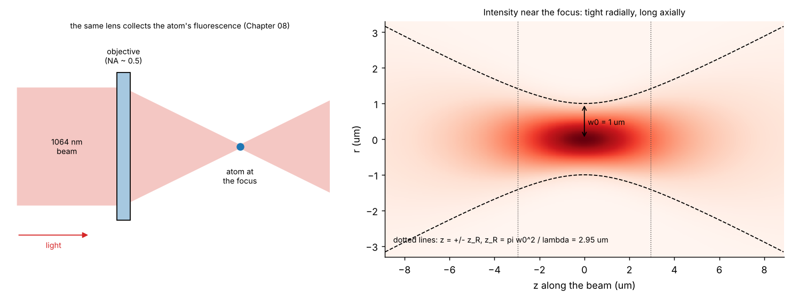
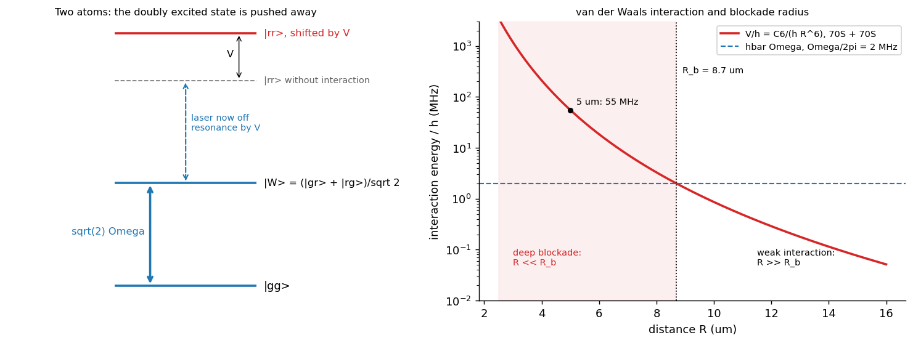
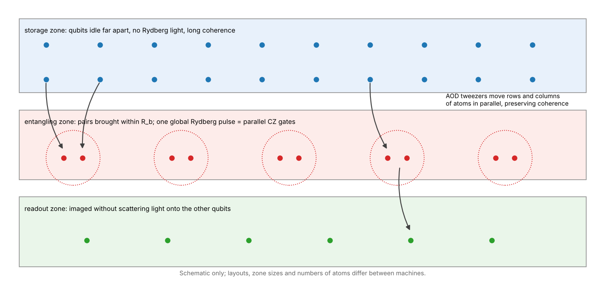

# Neutral-atoms-journey

*A from-scratch, beginner-friendly course on neutral atoms and optical-tweezer arrays, plus the papers I'd hand a newcomer.*

---

## 👋 Hey there

This repo is the introduction to neutral-atom quantum hardware I wish I'd had when I started: a course built **from scratch**, assuming nothing beyond undergraduate physics and a little linear algebra, that takes you from "what does a laser do to an atom?" to Rydberg entangling gates and the architectures being built for quantum error correction.

The first half follows **Metcalf and van der Straten's review _Laser cooling and trapping of atoms_** ([Utrecht preprint](https://webspace.science.uu.nl/~strat102/preprint/handpubl.pdf), J. Opt. Soc. Am. B 20, 887 (2003)). The second half is structured after graduate atomic-physics courses and the standard reviews on tweezer arrays and Rydberg atoms (see the [paper map](tutorial/paper-map.md)). Every explanation is written in my own words, every derived number is recomputed from a small set of tabulated atomic data, and every simulation checks itself against an independent result.

If you find it useful, a ⭐ genuinely makes my day, and corrections are always welcome.

---

## 📖 The tutorial

Start with the index, then work through the chapters in order.

- 📑 [**Tutorial index**](tutorial/README.md)
- 🧭 [**Guided learning path, exercises and answers**](tutorial/learning-path.md)
- 🔎 [**Notation and Rb-87 reference numbers**](tutorial/00-notation.md) · [**Map to the sources**](tutorial/paper-map.md)

| # | Chapter |
|---|---------|
| | **Part I: atoms and light** |
| 01 | [Introduction: Why Neutral Atoms](tutorial/01-introduction.md) |
| 02 | [The Atom: Levels, Fine and Hyperfine Structure](tutorial/02-atomic-structure.md) |
| 03 | [A Two-Level Atom in a Laser Field](tutorial/03-atom-light.md) |
| 04 | [Optical Forces: Radiation Pressure and the Dipole Force](tutorial/04-optical-forces.md) |
| 05 | [Slowing and Doppler Cooling](tutorial/05-doppler-cooling.md) |
| 06 | [Sub-Doppler Cooling and the Magneto-Optical Trap](tutorial/06-sub-doppler-mot.md) |
| | **Part II: single atoms in tweezers** |
| 07 | [Optical Dipole Traps and Tweezers](tutorial/07-optical-tweezers.md) |
| 08 | [Loading, Imaging and Assembling Atom Arrays](tutorial/08-arrays.md) |
| 09 | [Atomic Qubits, Single-Qubit Gates and Coherence](tutorial/09-qubits-coherence.md) |
| | **Part III: computing with Rydberg atoms** |
| 10 | [Rydberg Atoms and the Blockade](tutorial/10-rydberg.md) |
| 11 | [Rydberg Entangling Gates and Their Errors](tutorial/11-rydberg-gates.md) |
| 12 | [Toward Fault Tolerance: Readout, Loss, Erasure and Zoned Architectures](tutorial/12-architectures.md) |

### A look inside

Every chapter mixes derivations with pictures. All figures are original and regenerate from the scripts in [`tutorial/figures/`](tutorial/figures/); the numbers in them come from one shared reference file for Rb-87.

<table>
<tr>
<td align="center" width="33%"><a href="tutorial/01-introduction.md"></a><br><sub>The experimental cycle (ch01)</sub></td>
<td align="center" width="33%"><a href="tutorial/02-atomic-structure.md"></a><br><sub>The Rb-87 level diagram (ch02)</sub></td>
<td align="center" width="33%"><a href="tutorial/06-sub-doppler-mot.md"></a><br><sub>Sisyphus cooling (ch06)</sub></td>
</tr>
<tr>
<td align="center"><a href="tutorial/07-optical-tweezers.md"></a><br><sub>An optical tweezer (ch07)</sub></td>
<td align="center"><a href="tutorial/10-rydberg.md"></a><br><sub>The Rydberg blockade (ch10)</sub></td>
<td align="center"><a href="tutorial/12-architectures.md"></a><br><sub>Zoned architectures (ch12)</sub></td>
</tr>
</table>

---

## 🧪 Hands-on labs

Reading is good, but doing sticks. The [**hands-on/**](hands-on/README.md) track simulates the physics on your laptop with NumPy, SciPy and [QuTiP](https://qutip.org), with labs for chapters 03 and 05 to 12:

| Lab | You simulate | Theory |
|---|---|---|
| [Optical Bloch equations](hands-on/01-optical-bloch/) | damped Rabi oscillations, saturation, power broadening | ch03 |
| [Zeeman slower](hands-on/02-zeeman-slower/) | slowing a thermal beam with a designed field | ch05 |
| [Doppler molasses](hands-on/03-doppler-molasses/) | photon-by-photon cooling to the Doppler limit | ch05 |
| [MOT](hands-on/04-mot/) | restoring force, damping and capture | ch06 |
| [Tweezer trap](hands-on/05-tweezer-trap/) | polarizability, depth, trap frequencies, scattering | ch07 |
| [Release and recapture](hands-on/06-release-recapture/) | measuring a single atom's temperature | ch07 |
| [Rearrangement](hands-on/07-rearrangement/) | 50% loading and atom-by-atom assembly | ch08 |
| [Imaging fidelity](hands-on/08-imaging-fidelity/) | photon histograms, threshold, detection error | ch08 |
| [Ramsey dephasing](hands-on/09-ramsey-dephasing/) | thermal $T_2^*$ and spin echo | ch09 |
| [Rydberg blockade](hands-on/10-rydberg-blockade/) | blockade, $\sqrt N$ enhancement, scaling laws | ch10 |
| [CZ gate](hands-on/11-cz-gate/) | the Levine and Jaksch gates and their error budget | ch11 |
| [Erasure code](hands-on/12-erasure-code/) | why detected errors are easier to correct | ch12 |
| [Adiabatic Z2 crystal](hands-on/13-adiabatic-z2/) | analog simulation: preparing an ordered Rydberg chain | ch10 |

Install the requirements, then run all thirteen labs with their physics checks:

```bash
python -m pip install -r hands-on/requirements.txt
```

```bash
python hands-on/run_labs.py --all --check
```

To regenerate every tutorial figure and check all local links:

```bash
python tutorial/figures/make_figures.py
```

```bash
python tools/check_repo.py
```

The [review notes](REVIEW.md) record what was checked, how, and what is out of scope.

---

## 🚀 Recommended reading / start here

If you read nothing else, read these. They pair naturally with the three parts of the course:

- **Laser cooling and trapping of atoms**, Metcalf and van der Straten, 2003 → [Utrecht preprint](https://webspace.science.uu.nl/~strat102/preprint/handpubl.pdf) · [doi:10.1364/JOSAB.20.000887](https://doi.org/10.1364/JOSAB.20.000887)
- **Optical dipole traps for neutral atoms**, Grimm, Weidemüller and Ovchinnikov, 2000 → [arXiv:physics/9902072](https://arxiv.org/abs/physics/9902072)
- **Quantum information with Rydberg atoms**, Saffman, Walker and Mølmer, 2010 → [arXiv:0909.4777](https://arxiv.org/abs/0909.4777)

For the full annotated reading list, organised to follow the tutorial (and including the theses and recent papers I keep in my own bibliography), see [**reading-list/README.md**](reading-list/README.md).

> 📎 Papers and theses are **linked, not re-hosted**, so copyright stays with the authors and publishers. Please access them through arXiv, the publisher, or the university repository.

---

## 🎯 Who this is for

- Students joining a neutral-atom, optical-tweezer or Rydberg lab.
- Quantum-information and software people who want to understand the hardware underneath.
- Anyone curious with undergraduate physics who wants a guided, self-contained on-ramp.

You do **not** need prior atomic-physics experience. Comfort with basic quantum mechanics (two-level systems, the Schrödinger equation), linear algebra and some optics is enough.

## 🧭 How to use it

- **Read in order.** Each chapter assumes the previous ones.
- **Keep the primary text open** for Part I; the chapters are meant to make it easier to read, not to replace it.
- **Predict, then run.** Every lab prints numbers you can compute on paper first.
- **Treat numbers as illustrative.** Values are typical, computed for Rb-87 with stated parameters; real experiments vary, so check the literature for any specific machine.

---

## 🤝 Contributing

This is a living document and I'd love help making it clearer and more correct.

- Spotted an error, an unclear explanation, or a broken link? **Open an issue.**
- Want to improve a chapter or suggest a paper for the reading list? **Open a pull request.**
- Found it useful? A **⭐** is appreciated and helps others discover it.

Contributions should stay original and cite only public sources (arXiv, textbooks, published papers and theses).

## 📜 License

Everything in this repo (the tutorial writing, figures, reading-list annotations and code) is released under [**Creative Commons Attribution 4.0 (CC BY 4.0)**](https://creativecommons.org/licenses/by/4.0/). Reuse and adapt freely; just credit back. See [`LICENSE`](LICENSE).

**Linked papers and theses** remain under the copyright of their authors and publishers; they are referenced here, not redistributed.

---

📫 Questions or suggestions: [open an issue](../../issues) · maintained under the handle **Iamsohungrynow**.
