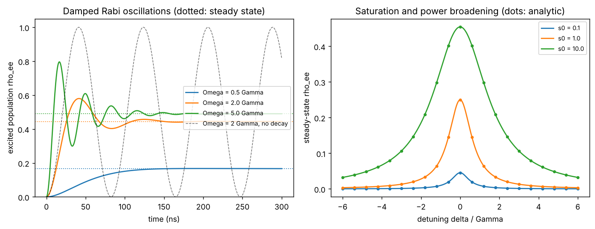

# Optical Bloch equations

Theory: [Chapter 03](../../tutorial/03-atom-light.md)

## What you simulate

A two-level atom (the Rb-87 D2 cycling transition, $\Gamma/2\pi=6.0666$ MHz)
driven by a laser with Rabi frequency $\Omega$ and detuning
$\delta=\omega_L-\omega_0$. In the rotating frame

    H/hbar = -delta |e><e| + (Omega/2) (|e><g| + |g><e|)

and spontaneous emission enters as the collapse operator sqrt(Gamma) |g><e|.
QuTiP's master-equation solver then integrates the optical Bloch equations.

You do two numerical experiments:

1. **Damped Rabi oscillations.** Start in $|g\rangle$, switch on a resonant
   laser with $\Omega=0.5,\ 2,\ 5\,\Gamma$, and watch the excited population
   oscillate and settle to its steady-state value.
2. **Line shape.** Compute the steady-state excited population as a function of
   detuning for saturation parameters $s_0=0.1,\ 1,\ 10$ and measure the
   power-broadened width.

Convention: $|g\rangle$ = basis(2, 0), $|e\rangle$ = basis(2, 1); time in us,
angular frequencies in rad/us, so `GAMMA = 2*np.pi*6.0666`.

## Run it

Run these commands from the **repository root**, using the environment from the [shared setup](../README.md).

    python -m pip install -r hands-on/requirements.txt
    python hands-on/01-optical-bloch/obe.py

## The code explained

The Hamiltonian, projector and lowering operator are built from two basis
kets:

    Pe = e * e.dag()
    sig = g * e.dag()
    H = -delta * Pe + 0.5 * Omega * (e * g.dag() + g * e.dag())

`mesolve` integrates the master equation from the ground state with the decay
operator `np.sqrt(GAMMA) * sig` and returns the excited population over 300 ns,
about eleven lifetimes. For the line shape we skip the time evolution and ask
QuTiP for the steady state directly:

    rho_ss = steadystate(H, [np.sqrt(GAMMA) * sig])
    expect(Pe, rho_ss)

The analytic result $\rho_{ee}=(s_0/2)/(1+s_0+(2\delta/\Gamma)^2)$ with
$s_0=2\Omega^2/\Gamma^2$ is computed alongside. A small helper finds the full
width at half maximum of each numerical line by linear interpolation.

## Expected output

    Omega = 0.5 Gamma: first maximum rho_ee = 0.1674, value at 300 ns = 0.1667, analytic steady state = 0.1667
    Omega = 2.0 Gamma: first maximum rho_ee = 0.5800, value at 300 ns = 0.4445, analytic steady state = 0.4444
    Omega = 5.0 Gamma: first maximum rho_ee = 0.7960, value at 300 ns = 0.4901, analytic steady state = 0.4902
    s0 =   0.1: peak rho_ee = 0.0455 (analytic 0.0455); FWHM = 6.363 MHz (Gamma*sqrt(1+s0)/2pi = 6.363 MHz)
    s0 =   1.0: peak rho_ee = 0.2500 (analytic 0.2500); FWHM = 8.581 MHz (Gamma*sqrt(1+s0)/2pi = 8.579 MHz)
    s0 =  10.0: peak rho_ee = 0.4545 (analytic 0.4545); FWHM = 20.121 MHz (Gamma*sqrt(1+s0)/2pi = 20.121 MHz)
    Scattering rate at s0 = 10 on resonance: 1.733e+07 photons/s (limit Gamma/2 = 1.906e+07)

Left: the weakly driven atom ($\Omega=0.5\,\Gamma$) creeps up to its steady
state with only a tiny overshoot (0.1674 against 0.1667). On resonance the
Bloch equations oscillate only when $\Omega>\Gamma/4$; at $\Omega=0.5\,\Gamma$ the
oscillation frequency is $\sqrt{\Omega^2-\Gamma^2/16}\approx0.43\,\Gamma$ while the
damping rate is $3\Gamma/4$, so the ringing dies out within one period. The strongly
driven atom ($\Omega=5\,\Gamma$) overshoots to 0.80 before ringing down to
0.49, close to the saturation limit of 1/2. The dashed curve is the same drive
without decay: a perfect $\sin^2(\Omega t/2)$. Right: as $s_0$ grows the peak
saturates toward 1/2 and the line broadens; the dots are the analytic formula.

With `--check`, the runner verifies five things: the no-decay limit equals
$\sin^2(\Omega t/2)$; the numerical steady state equals the analytic formula at
every detuning; the time evolution relaxes to that steady state; the width
equals $\Gamma\sqrt{1+s_0}$ within 0.5%; and QuTiP's master-equation solution
agrees with an independent integration (SciPy) of the optical Bloch equations
exactly as written in Chapter 03, which tests the decay terms and their signs.

## Try this

1. Change the detuning in Part 1 to $\delta=-2\Gamma$. The oscillations get
   faster (generalized Rabi frequency $\sqrt{\Omega^2+\delta^2}$) and the steady
   state drops. Predict the new steady state from the formula before running.
2. Set `GAMMA` to the D1 value, $2\pi\times5.750$ rad/us. What changes in the
   widths, and what stays the same when you express everything in units of
   $\Gamma$?
3. Add pure dephasing (for example laser phase noise) with an extra collapse
   operator `np.sqrt(gamma_phi) * Pe`. The line broadens beyond
   $\Gamma\sqrt{1+s_0}$, and the steady state at resonance changes. Why?
