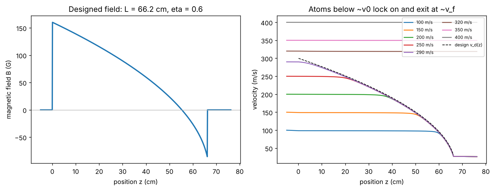

# Zeeman slower

Theory: [Chapter 05](../../tutorial/05-doppler-cooling.md)

## What you simulate

A Rb-87 atom flies along $+z$ into a counter-propagating, $\sigma^+$-polarized
slowing beam. Its effective detuning combines the laser detuning, the Doppler
shift and the Zeeman shift of the cycling transition ($\mu'=\mu_B$):

    delta_eff(z, v) = delta_L + k v - mu_B B(z) / hbar

and it feels the full Lorentzian scattering force (Chapter 04). You first
**design** a slower for constant deceleration $a=\eta\,a_{\max}$, from a capture
velocity $v_0=300$ m/s down to $v_f=30$ m/s, then integrate trajectories for atoms
entering at 100 to 400 m/s and see which ones are captured.

Design values (illustrative): $\eta=0.6$, $s_0=3$, $\delta_L/2\pi=-160$ MHz.

## Run it

Run these commands from the **repository root**, using the environment from the [shared setup](../README.md).

    python -m pip install -r hands-on/requirements.txt
    python hands-on/02-zeeman-slower/slower.py

## The code explained

The design velocity and the field that keeps it resonant are one line each:

    v_design(z) = sqrt(v0**2 - 2*a*z)
    B(z) = hbar * (delta_L + k * v_design(z)) / muB      # inside 0 <= z <= L, else 0

`solve_ivp` integrates $\dot z=v$, $\dot v=F(z,v)/m$ with a small maximum step
(the force changes over a few cm) and stops when the atom leaves the slower
region or is pushed backward.

The force balance predicts how far a locked atom lags behind the design
velocity: the force equals $m\,a$ when
$s_0/(1+s_0+x^2)=\eta$ with $x=2\delta_{\rm eff}/\Gamma$. With $s_0=3$ and
$\eta=0.6$ this gives $x=1$, a lag of $\Gamma/2k=2.37$ m/s. The script measures
the actual lag in the middle third of the slower and compares.

## Expected output

    a_max = 1.122e+05 m/s^2; design deceleration eta*a_max = 6.729e+04 m/s^2
    length L = (v0^2 - v_f^2)/(2 eta a_max) = 0.662 m
    field at entrance +160.4 G, at exit -86.8 G
    detuning after the slower for v_f: -20.0 Gamma
    predicted lag behind v_design: 2.37 m/s (x = 1.00)
    v_init = 100 m/s -> v_exit =   26.4 m/s
    ...
    v_init = 290 m/s -> v_exit =   26.4 m/s
    v_init = 320 m/s -> v_exit =  318.9 m/s
    v_init = 350 m/s -> v_exit =  349.7 m/s
    v_init = 400 m/s -> v_exit =  399.9 m/s
    measured lag in the middle of the slower: 2.43 m/s

Left: the designed field. It falls from $+160$ G, crosses zero, and ends at
$-87$ G, where it drops abruptly to zero. Right: every atom slower than about
300 m/s coasts until the resonance condition reaches it, locks on just below the
dashed design curve, and leaves at 26 m/s ($v_f$ minus the lag and a little extra
deceleration at the exit). Atoms above the capture velocity are never resonant
and pass through almost unchanged.

The runner checks four things: the length formula; capture of all atoms below
$v_0$ to within 5 m/s of $v_f$ minus the lag; no capture above $v_0$; and the
measured lag against the force balance (10%).

## Try this

1. Raise $\eta$ to 0.8, above $s_0/(1+s_0)=0.75$. The slower gets shorter, but
   atoms can no longer keep up with the resonance and fall out of lock. Find the
   largest $\eta$ that still works.
2. Lower $s_0$ to 1 while keeping $\eta=0.6$. Predict the new lag from the force
   balance first. (Is there a solution at all?)
3. Add a 5% error to $B(z)$ near the middle of the slower. How robust is the
   exit velocity? Real coils are never perfect.
