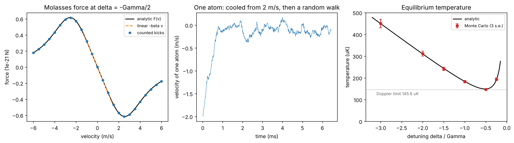

# Doppler molasses, photon by photon

Theory: [Chapter 05](../../tutorial/05-doppler-cooling.md)

## What you simulate

Rb-87 atoms in one-dimensional optical molasses: two counter-propagating beams,
each with saturation parameter $s_0=0.05$ and detuning $\delta$. Rather than
using the friction formula, the simulation applies **individual photon kicks**.
An atom with velocity $v$ absorbs from the $+z$ beam at rate $R_+(v)$ and from
the $-z$ beam at rate $R_-(v)$ (Lorentzians at detunings $\delta\mp kv$). Each
absorption is a kick of $\pm\hbar k$, followed by an emission kick of $\pm\hbar k$
with equal probability (a 1D emission model, stated explicitly because the
predicted temperature depends on it).

Between events nothing happens to the velocity, so the simulation is **exact**:
draw the waiting time from an exponential distribution with rate $R_++R_-$,
pick which beam was absorbed, apply both kicks, repeat. This is the Gillespie
algorithm.

Analytic predictions for this model, with $x=2|\delta|/\Gamma$:

- friction: $\beta=-8\hbar k^2\delta s_0/[\Gamma(1+s_0+x^2)^2]$
- temperature: $k_BT=\frac{\hbar\Gamma}{4}(1+s_0+x^2)/x$, minimal at $\delta\approx-\Gamma/2$

## Run it

Run these commands from the **repository root**, using the environment from the [shared setup](../README.md).

    python -m pip install -r hands-on/requirements.txt
    python hands-on/03-doppler-molasses/molasses.py

## The code explained

The heart of the simulation is a vectorized event loop over 3000 independent
atoms:

    rp, rm = rates(v, delta)
    dt = rng.exponential(1.0 / (rp + rm))
    absorb = np.where(rng.random(n_atoms) < rp / (rp + rm), 1.0, -1.0)
    emit = rng.choice([-1.0, 1.0], n_atoms)
    v = v + (absorb + emit) * vr

After a burn-in of 2000 events (many damping times), the script accumulates the
**time-weighted** average of $v^2$ for each atom, because the atom spends a time
`dt` at each velocity. The temperature is $T=m\langle v^2\rangle/k_B$, and its
standard error comes from the spread across atoms, which are independent.

The friction is measured separately by holding the velocity fixed, drawing a
very large number of absorptions and counting how many came from each beam:
the mean force is $\hbar k(N_+-N_-)$ divided by the elapsed time.

## Expected output

    friction at delta = -Gamma/2: beta_sim = 3.248e-22 kg/s, beta_analytic = 3.255e-22 kg/s
    velocity damping time m/beta = 0.443 ms
     delta/Gamma   T_sim (uK)          T_analytic (uK)
       -0.25       193.5 +/-  2.1        189.2
       -0.50       147.0 +/-  1.3        149.2
       -1.00       182.8 +/-  1.8        183.8
       -1.50       241.8 +/-  2.8        243.8
       -2.00       311.4 +/-  3.9        310.3
       -3.00       450.2 +/-  6.8        449.5
    Doppler limit hbar Gamma/2k_B = 145.6 uK; minimum of the s0 = 0.05 curve = 149.2 uK

Left: the force counted from simulated kicks lies on the analytic curve,
linear only for $|v|\lesssim2$ m/s. Middle: one atom starting at $-2$ m/s is
damped within about a millisecond, then wanders randomly; the size of that
wandering is the temperature. Right: the simulated temperatures follow the
analytic curve, with the minimum at $\delta=-\Gamma/2$, just above the Doppler
limit (the small excess comes from $s_0=0.05$).

The runner checks that the counted forces match the analytic $F(v)$, that the
small-velocity slope matches $\beta$ within 5%, that every temperature matches
the analytic formula within 4% plus three standard errors, and that the coldest
point is at $-\Gamma/2$ within 5% of $T_D$. The 4% allowance covers the
nonlinearity of the force at the smallest detuning, where $kv$ is not much
smaller than $|\delta|$.

## Try this

1. Change the emission model to isotropic emission projected on the axis,
   `emit = rng.uniform(-1, 1, n_atoms)` (variance 1/3 instead of 1). The
   heating per event drops from $2(\hbar k)^2$ to $\frac43(\hbar k)^2$, so the
   prediction becomes $\frac23$ of the formula above. Check it.
2. Increase $s_0$ to 1. The independent-beam rates are still used, so the code
   agrees with the formula, but in a real atom the two beams saturate each other.
   What would you have to change to model that?
3. Replace Rb with strontium on its 689 nm intercombination line,
   $\Gamma/2\pi=7.4$ kHz. What Doppler limit do you get? Compare it with the
   recoil temperature of Sr-88 at 689 nm: when $T_D$ falls below $T_r$, the
   assumption that each kick is small breaks down.
