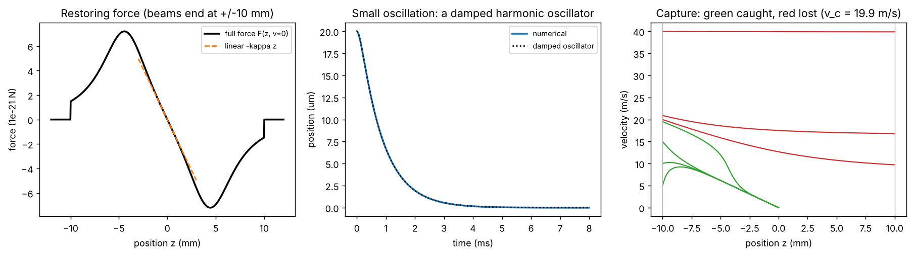

# A one-dimensional MOT

Theory: [Chapter 06](../../tutorial/06-sub-doppler-mot.md)

## What you simulate

The textbook 1D magneto-optical trap: an atom with a $J=0$ ground state and a
$J'=1$ excited state, a linear field $B=Az$, and two red-detuned beams, a
$\sigma^+$ beam travelling along $+z$ and a $\sigma^-$ beam along $-z$. The Zeeman
shift $\pm\mu'Az/\hbar$ of the $m'=\pm1$ levels enters the detuning exactly like
the Doppler shift $\pm kv$:

    beam along +z :  delta - k v - mu' A z / hbar
    beam along -z :  delta + k v + mu' A z / hbar

Expanding the total force for small $z$ and $v$ gives $F=-\beta v-\kappa z$ with
$\kappa=\mu'A\beta/(\hbar k)$: a damped harmonic oscillator.

Parameters (illustrative, Rb-87 D2): $\delta=-\Gamma$, $s_0=1$ per beam,
$A=10$ G/cm, $\mu'=\mu_B$, beams of radius 1 cm (no force outside them).

## Run it

Run these commands from the **repository root**, using the environment from the [shared setup](../README.md).

    python -m pip install -r hands-on/requirements.txt
    python hands-on/04-mot/mot.py

## The code explained

`force(z, v)` is the difference of two Lorentzian scattering forces. The script
computes $\beta$ and $\kappa$ analytically and also by central finite
differences of `force` at the origin.

A small displacement (20 um, released at rest) is integrated with `solve_ivp`
and compared with the analytic solution of $m\ddot z=-\beta\dot z-\kappa z$. The
code picks the underdamped or overdamped form automatically from the sign of
$(\beta/2m)^2-\kappa/m$.

The capture velocity is found by bisection: atoms start at the edge of the
beams, $z=-1$ cm, with velocity $v$, and count as captured if they never leave
$|z|\le1$ cm. An energy argument gives a strict upper bound. The force can never
exceed $F_{\max}=\hbar k\frac{\Gamma}{2}\frac{s_0}{1+s_0}$, so over the 2 cm path
across the beams it can remove at most $2F_{\max}R$ of kinetic energy:
$v_c<\sqrt{4F_{\max}R/m}$.

## Expected output

    beta  = 1.5197e-21 kg/s   (numerical derivative 1.5197e-21)
    kappa = 1.6596e-18 N/m   (numerical derivative 1.6596e-18)
    trap frequency omega0/2pi = 539.7 Hz, damping rate beta/m = 10530.5 1/s
    damping ratio (beta/m)/(2 omega0) = 1.55 (overdamped)
    force maximum near |z| = |delta| hbar/(mu' A) = 4.33 mm (linear only for |z| < ~2 mm)
    capture velocity (beam radius 1 cm): 19.9 m/s; energy bound sqrt(4 F_max R/m) = 47.4 m/s
    max deviation from damped-oscillator solution: 0.000% of z0

Left: the restoring force is linear for a few millimetres, peaks where the
Zeeman shift equals the detuning, then falls off; it vanishes outside the beams.
Middle: a displaced atom returns to the centre within a couple of milliseconds (slowest decay time 0.8 ms) without
overshooting, because the trap is overdamped. Right: phase-space trajectories of
atoms entering from the left. Slow atoms are first *accelerated* toward the
centre (the force at the edge points inward) and then damped; atoms faster than
20 m/s cross the beams and escape.

The runner checks the two derivatives against the formulas, the small
oscillation against the analytic solution, the sign of the force across the
beams, and that the capture velocity lies between 30% and 100% of the energy
bound.

## Try this

1. Change the detuning to $-2\Gamma$ and $-3\Gamma$. Predict how $\beta$,
   $\kappa$ and the capture velocity change, then check. Is the trap still
   overdamped?
2. Double the gradient to 20 G/cm. Which quantities change, and which do not?
3. Flip the sign of `A` (equivalently, swap the beam polarizations). Confirm
   that the "trap" now expels atoms.
