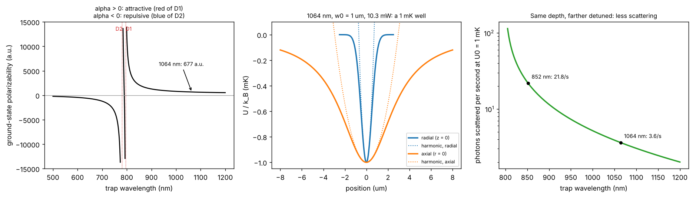

# An optical tweezer for Rb-87

Theory: [Chapter 07](../../tutorial/07-optical-tweezers.md)

## What you simulate

The ground-state polarizability of Rb-87 from 500 to 1200 nm, modelled as two
Lorentz oscillators (D1 and D2, weights 1/3 and 2/3, counter-rotating terms
kept):

    alpha(w) = sum  wt * 6 pi eps0 c^3 (Gamma/w0^2) / (w0^2 - w^2)

Then a Gaussian focus of waist $w_0=1\ \mu$m: its depth per milliwatt, the power
for a 1 mK trap, the radial and axial trap frequencies, the photon scattering
rate and the resulting recoil heating, for 1064 nm and 852 nm tweezers.

## Run it

Run these commands from the **repository root**, using the environment from the [shared setup](../README.md).

    python -m pip install -r hands-on/requirements.txt
    python hands-on/05-tweezer-trap/tweezer.py

The script needs only NumPy, SciPy and Matplotlib.

## The code explained

`alpha(lam)` and `scatter_rate(lam, I)` implement the two formulas of Chapter 07
line by line. `potential(r, z, lam, P, w0)` builds the full Gaussian-beam
potential including the axial widening $w(z)=w_0\sqrt{1+(z/z_R)^2}$, so nothing
is assumed harmonic. `summary` returns the depth, the harmonic frequencies
$\omega_r=\sqrt{4U_0/mw_0^2}$, $\omega_z=\sqrt{2U_0/mz_R^2}$, the Rayleigh range and
the scattering rate at the centre.

The tune-out wavelength is found with `brentq`, which looks for the zero of
$\alpha$ between the two D lines. The harmonic frequencies are checked against a
second-order finite difference of the full potential at the trap centre.

## Expected output

    static polarizability  alpha(0) = 308.2 a.u. (measured: 318.8 a.u.)
    tune-out wavelength between D2 and D1: 790.03 nm
    1064 nm: alpha =   677.3 a.u.; depth per mW (w0 = 1 um) =   97.0 uK = h x 2.02 MHz
            for U0 = 1 mK: P = 10.31 mW, f_r =  98.5 kHz, f_z = 23.6 kHz, zR = 2.95 um
            scattering   3.6 photons/s, recoil heating 2 E_r Gamma_sc = 0.70 uK/s
    852 nm: alpha =  2070.0 a.u.; depth per mW (w0 = 1 um) =  296.4 uK = h x 6.18 MHz
            for U0 = 1 mK: P =  3.37 mW, f_r =  98.5 kHz, f_z = 18.9 kHz, zR = 3.69 um
            scattering  21.8 photons/s, recoil heating 2 E_r Gamma_sc = 6.61 uK/s
    curvature check: f_r numerical 98.454 kHz vs analytic 98.454 kHz; f_z 23.578 vs 23.578 kHz

Left: the polarizability diverges at each D line and changes sign; red of D1 it
is positive and the tweezer attracts the atom. Middle: radial and axial cuts of
the 1 mK, 1064 nm well and their harmonic approximations, which are accurate
only near the bottom. Right: at a fixed depth of 1 mK the scattering rate falls
steadily with wavelength.

Notice that the radial frequency is the same (98.5 kHz) at both wavelengths:
it depends only on $U_0$ and $w_0$. The axial frequency is lower at 852 nm
because the Rayleigh range $\pi w_0^2/\lambda$ is longer.

The runner checks the two harmonic frequencies against the numerical curvature,
the depth per mW against the reference table, the signs of $\alpha$ on either side
of the D lines and the position of the tune-out wavelength, and the static
limit against the measured 318.8 a.u. (within 5%; the missing 3% comes from
higher P states and the polarizable ionic core).

## Try this

1. Find the waist that gives the same 1 mK depth at 1064 nm with only 5 mW.
   What happens to the trap frequencies and to the scattering rate?
2. Compare 1064 nm and 852 nm at equal *power* rather than equal depth. Which is
   better for a laser-power-limited array of 1000 tweezers?
3. If ARC is installed (`pip install arc-alkali-rydberg-calculator`), compute the
   polarizability at 1064 nm with its full sum over states and compare with the
   two-line result. Expect agreement at the percent level.
