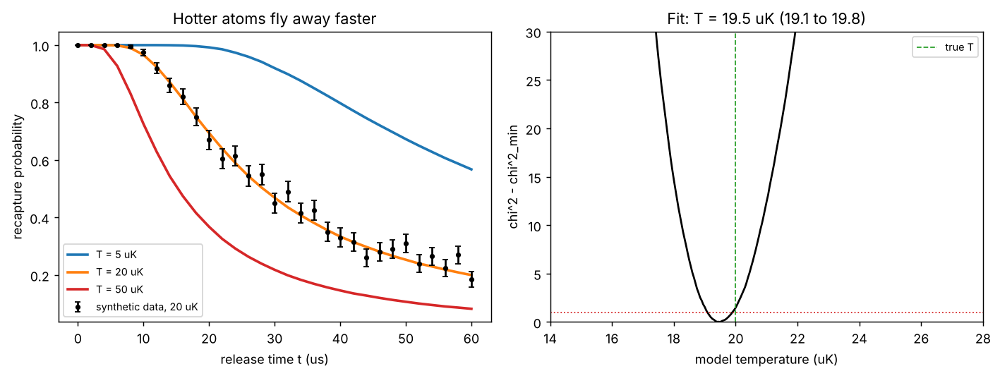

# Release-and-recapture thermometry

Theory: [Chapter 07](../../tutorial/07-optical-tweezers.md) (also used in [Chapter 08](../../tutorial/08-arrays.md))

## What you simulate

How do you measure the temperature of a single atom? Switch its tweezer off for
a time $t$, let the atom fly freely, switch the tweezer back on, and check
whether the atom is still there. Repeat many times: the recapture probability
$P(t)$ falls faster for hotter atoms. The temperature is extracted by comparing
the measured curve with simulations.

This lab runs the simulation for a 1 mK, 1064 nm tweezer with a 1 $\mu$m waist
($f_r=98.5$ kHz, $f_z=23.6$ kHz):

1. Draw 40 000 atoms from the thermal phase-space distribution of the harmonic
   approximation (Gaussian positions and velocities).
2. Fly them ballistically for time $t$, with gravity (the tweezer axis is $z$ and gravity points along $x$, as for a horizontal tweezer beam; at these times gravity moves the atom by only nanometres).
3. Recapture an atom if its total energy in the full Gaussian potential is
   negative.

It then generates a synthetic "experiment" at 20 $\mu$K with 200 shots per
release time and fits it.

## Run it

Run these commands from the **repository root**, using the environment from the [shared setup](../README.md).

    python -m pip install -r hands-on/requirements.txt
    python hands-on/06-release-recapture/recapture.py

## The code explained

The script draws one fixed set of standard-normal random numbers and rescales
it for each temperature:

    x = sqrt(kB*T/(m*wr**2)) * Z[0]       # and similarly y, z
    vx = sqrt(kB*T/m) * Z[3]              # and similarly vy, vz

Reusing the same random numbers ("common random numbers") makes the simulated
$P(t)$ a smooth function of $T$, which is what you need for fitting. Atoms
whose harmonic energy is above $U_0$ would not be bound and are discarded; at
these temperatures there are none.

The recapture condition is the total energy in the *full* potential,
$\frac12mv^2+U(\mathbf r)<0$. Since the Gaussian well lies below its harmonic
approximation, every kept atom is bound at $t=0$.

The fit computes $\chi^2$ between the synthetic data and simulations on a fine
temperature grid; the 1-sigma range is where $\chi^2$ is within 1 of its minimum.

## Expected output

    trap frequencies f_r = 98.5 kHz, f_z = 23.6 kHz
    T =    5 uK: P(0) = 1.000, P(20 us) = 0.992, P(40 us) = 0.798  (harmonic samples above U0: 0.00%)
    T =   20 uK: P(0) = 1.000, P(20 us) = 0.694, P(40 us) = 0.334  (harmonic samples above U0: 0.00%)
    T =   50 uK: P(0) = 1.000, P(20 us) = 0.368, P(40 us) = 0.146  (harmonic samples above U0: 0.00%)
    mean harmonic energy at 20 uK = 2.9929 +/- 0.0086 kB T (expect 3)
    fit to synthetic data (T_true = 20 uK, 200 shots/point): T = 19.50 uK, 1-sigma range 19.10-19.85 uK

Left: recapture probability versus release time for 5, 20 and 50 $\mu$K, with the
synthetic 20 $\mu$K data. For the first few microseconds nothing happens: the
atom has not yet moved out of the well. Right: $\chi^2$ versus model
temperature; the fit lands about 1.3 standard deviations from the true
value. Note that the synthetic data are generated from the same random atoms as
the model curves, so this tests the effect of finite shot noise on the fit, not
Monte Carlo noise.

The runner checks that $P(0)=1$, that the untruncated samples have mean energy
$3k_BT$ (equipartition over six quadratic terms), that $P$ falls with both $t$
and $T$, and that the fit recovers the true temperature within three standard
deviations and 10%.

## Try this

1. Lower the trap depth to 0.2 mK. Why does $P(t)$ now depend on the depth, and
   what does that mean for a real measurement in which $U_0$ is uncertain?
2. Replace the thermal (Boltzmann) energy distribution with that of an atom in
   the motional ground state, $\bar n=0$. What "temperature" does a fit with the
   thermal model return?
3. Reduce the number of shots per point to 50. How does the 1-sigma range scale?
