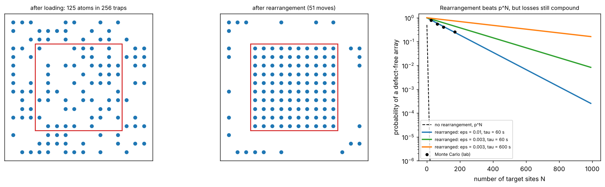

# Loading and rearranging an atom array

Theory: [Chapter 08](../../tutorial/08-arrays.md)

## What you simulate

1. **Collisional-blockade loading.** A Poisson number of atoms enters each
   tweezer and light-assisted collisions remove them in pairs, leaving
   $N\bmod2$ atoms. You check $P_1=(1-e^{-2\bar n})/2$.
2. **Rearrangement.** On $L\times L$ grids loaded with $p=0.5$, every empty site
   of a central target block is filled by moving one reservoir atom, chosen by a
   minimum-total-distance assignment (the Hungarian algorithm, SciPy's
   `linear_sum_assignment`). Each move fails with probability
   $\varepsilon=1\%$, and every atom can be lost to the vacuum during the
   0.2 s cycle (lifetime 60 s).

Since each hole costs exactly one move, the success probability has an exact
formula that does not depend on which reservoir atom is chosen:

    P = sum_h Binom(h; N, 1-p) * P(reservoir >= h) * (1-eps)^h * exp(-N t / tau)

## Run it

Run these commands from the **repository root**, using the environment from the [shared setup](../README.md).

    python -m pip install -r hands-on/requirements.txt
    python hands-on/07-rearrangement/rearrange.py

## The code explained

Loading by parity is a single line: `rng.poisson(nbar, n) % 2`.

For rearrangement, the function `rearrange_2d(L, n_target)` draws a random
occupancy grid, lists the holes inside the target and the atoms outside it, and
builds a cost matrix of Euclidean distances. `linear_sum_assignment` returns the
pairing that minimises the total distance. Each pairing becomes a move that
succeeds with probability $1-\varepsilon$. Finally every site survives the cycle
with probability $e^{-t/\tau}$, and the trial succeeds if the whole target is
full.

`p_success_analytic` evaluates the exact formula with SciPy's binomial
distribution, including the probability that the reservoir has enough atoms.
The curves in the right-hand panel use the large-reservoir limit of the same
formula to extend the comparison to 1000 sites.

## Expected output

    nbar = 0.25: P(single atom) MC = 0.1970, (1 - exp(-2 nbar))/2 = 0.1967
    nbar = 0.50: P(single atom) MC = 0.3154, (1 - exp(-2 nbar))/2 = 0.3161
    nbar = 1.00: P(single atom) MC = 0.4316, (1 - exp(-2 nbar))/2 = 0.4323
    nbar = 2.00: P(single atom) MC = 0.4911, (1 - exp(-2 nbar))/2 = 0.4908
    nbar = 4.00: P(single atom) MC = 0.4995, (1 - exp(-2 nbar))/2 = 0.4998
    site occupation: mean 0.4985 (p = 0.5), variance 0.2500 (p(1-p) = 0.2500)
    move loss 0.01, vacuum lifetime 60 s, cycle 0.2 s
     grid   target   N    P_success MC       analytic   no rearrangement
      8x8    5x5    25   0.797 +/- 0.010    0.788      2.7e-08
     12x12   8x8    64   0.557 +/- 0.013    0.543      4.4e-20
     16x16  10x10  100   0.411 +/- 0.013    0.434      5.7e-31
     20x20  13x13  169   0.252 +/- 0.011    0.244      7.6e-52

Left and middle: one realisation on a 16 × 16 grid. Right: the probability of a
defect-free array versus the number of target sites. Without rearrangement it
collapses as $2^{-N}$; with rearrangement it decays slowly, at a rate set by the
move loss and the vacuum lifetime.

The runner checks the parity formula, the binomial statistics of the occupancy,
the Monte Carlo success probability against the exact formula (within four
standard errors), and the enormous gain over $p^N$.

## Try this

1. Increase the loading probability to $p=0.8$ (enhanced loading). How much
   smaller can the grid be for the same target?
2. Make the move loss depend on the distance travelled, for example
   $\varepsilon=0.002+0.001\,d$ with $d$ in lattice sites. Does the Hungarian
   assignment now beat a random assignment?
3. Add a second rearrangement round that repairs the holes left by failed
   moves. How does the success probability for 169 sites change?
