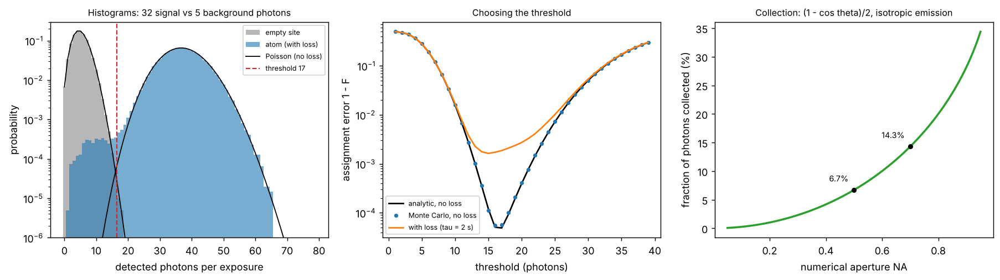

# Single-atom imaging fidelity

Theory: [Chapter 08](../../tutorial/08-arrays.md)

## What you simulate

Fluorescence imaging of one tweezer site. During a 20 ms exposure an atom
scatters $6\times10^4$ photons per second; a lens of NA 0.5 collects 6.7% of
them (isotropic emission), and optical losses and the camera's quantum
efficiency leave a detection efficiency of 2.7%. The camera pixels for that site
also collect background light.

    empty site:  n ~ Poisson(mu_b)                  mu_b = 5
    full site:   n ~ Poisson(mu_b + eta R t_on)     eta R t_exp = 32

where $t_{\rm on}$ is shortened if the atom is lost during the exposure
(exponential loss time with mean 2 s, i.e. 99% survival). The site is called
full if $n\ge$ threshold, and the assignment fidelity is
$F=1-\frac12[P(n\ge{\rm th}\mid{\rm empty})+P(n<{\rm th}\mid{\rm full})]$.

## Run it

Run these commands from the **repository root**, using the environment from the [shared setup](../README.md).

    python -m pip install -r hands-on/requirements.txt
    python hands-on/08-imaging-fidelity/imaging.py

## The code explained

`counts(full, with_loss)` draws 200 000 exposures. The analytic fidelity uses
SciPy's Poisson survival and cumulative distribution functions:

    F = 1 - 0.5 * (poisson.sf(th - 1, mu_b) + poisson.cdf(th - 1, mu_b + mu_s))

For equal prior probabilities the best threshold is the first count at which
the "full" probability exceeds the "empty" one. Setting the two Poisson
probabilities equal gives $n^*=\mu_s/\ln(1+\mu_s/\mu_b)$; the script checks that
the brute-force optimum is $\lceil n^*\rceil$.

## Expected output

    NA = 0.5: collection 6.70% -> detection efficiency 2.68%
    signal mu_s = eta R t = 32.2 photons, background mu_b = 5.0
    empty: mean 5.003, var 5.002; full: mean 37.16, var 37.15 (Poisson: mean = var)
    best threshold 17 (pmf crossing formula 17); fidelity analytic 0.999951, MC 0.999942
    with loss during imaging (tau = 2.0 s, survival 0.9900): best fidelity 0.99837
       NA = 0.3: collection fraction  2.30%
       NA = 0.5: collection fraction  6.70%
       NA = 0.7: collection fraction 14.29%
       NA = 0.9: collection fraction 28.21%

Left: count histograms on a log scale. Loss during imaging adds a low-count
tail to the "atom" distribution that reaches into the background peak. Middle:
the assignment error versus threshold; without loss it dips to
$5\times10^{-5}$ at threshold 17, while 1% loss raises the floor to
$1.6\times10^{-3}$. Right: the collected fraction of photons versus NA.

The runner checks the Poisson mean and variance of both distributions, the
Monte Carlo fidelity against the analytic formula at every threshold, the
optimal threshold against the crossing formula, and that loss lowers the best
fidelity.

## Try this

1. Halve the exposure time. How do the best threshold and the error change? Is
   the error now limited by the background or by loss?
2. Replace the camera with one that adds Gaussian read noise of 3 counts rms.
   Which part of the histogram suffers most?
3. With 99.5% survival required, what is the longest exposure you can afford at
   this loss rate, and what fidelity does it give?
