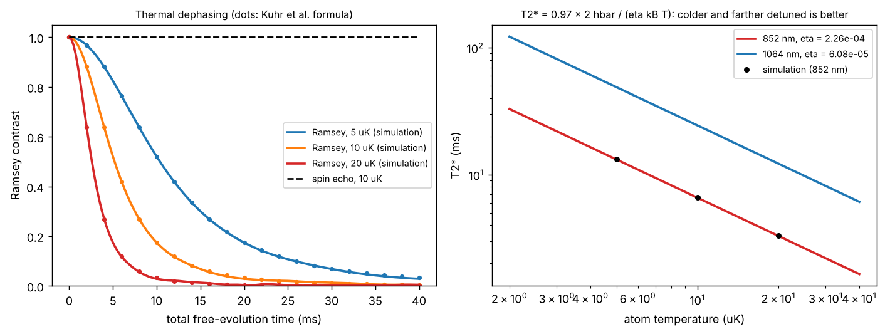

# Ramsey dephasing and spin echo in a tweezer

Theory: [Chapter 09](../../tutorial/09-qubits-coherence.md)

## What you simulate

A Rb-87 hyperfine clock qubit in an 852 nm, 1 mK tweezer ($f_r=98.5$ kHz,
$f_z=18.9$ kHz). The trap light shifts $|1\rangle$ by a fraction
$\eta=2.258\times10^{-4}$ more than $|0\rangle$ (two-line model of Chapter 07).
An atom moving in the trap sees an instantaneous qubit-frequency offset
proportional to its potential energy $V(t)$, so during a free evolution it
accumulates the phase

$$\phi=\frac{\eta}{\hbar}\int V(t)\,dt .$$

For 60 000 thermal atoms on exact classical harmonic trajectories, the integral
is computed in closed form per axis,
$\int_0^tE_i\cos^2(\omega_it'+\varphi_i)\,dt'=E_i\big[\tfrac t2+\tfrac{\sin2(\omega_it+\varphi_i)-\sin2\varphi_i}{4\omega_i}\big]$,
and the Ramsey contrast is $|\langle e^{i\phi}\rangle|$. The result is compared
with the analytic envelope of Kuhr et al.,

$$C(t)=\big[1+0.95\,(t/T_2^*)^2\big]^{-3/2},\qquad T_2^*=0.97\,\frac{2\hbar}{\eta k_BT}.$$

The same atoms then undergo a spin echo: the phase accumulated after a $\pi$
pulse at $t/2$ is subtracted.

## Run it

Run these commands from the **repository root**, using the environment from the [shared setup](../README.md).

    python -m pip install -r hands-on/requirements.txt
    python hands-on/09-ramsey-dephasing/ramsey.py

## The code explained

`energies_and_phases(T)` draws Gaussian positions and velocities for each axis
(one fixed set of random numbers, rescaled for each temperature) and converts
them into the energy $E_i$ and phase $\varphi_i$ of the motion
$x_i=A_i\cos(\omega_it+\varphi_i)$.

`V_integral(E, phi, t0, t1)` is the closed-form integral above, summed over the
three axes. Ramsey uses the phase from 0 to $t$; the echo uses the phase from 0
to $t/2$ minus the phase from $t/2$ to $t$.

The script does **not** assume that each atom's frequency offset is $\eta E/2\hbar$;
that time-averaging step of the analytic derivation emerges from the exact
trajectories, because the oscillating part of the integral is bounded by
$E/(4\omega)$ while the linear part grows as $Et/2$.

## Expected output

    T =    5 uK: T2* from simulation =  13.19 ms, Kuhr formula 0.97 * 2 hbar/(eta kB T) =  13.17 ms
    T =   10 uK: T2* from simulation =   6.59 ms, Kuhr formula 0.97 * 2 hbar/(eta kB T) =   6.59 ms
    T =   20 uK: T2* from simulation =   3.30 ms, Kuhr formula 0.97 * 2 hbar/(eta kB T) =   3.29 ms
    ratio T2*(5 uK)/T2*(20 uK) = 3.998 (expect 4)
    spin-echo contrast at t = 40 ms, 10 uK: 1.0000 (Ramsey: 0.0037)

Left: simulated contrast (lines) and the analytic formula (dots) for three
temperatures; the echo (dashed) stays at 1. Right: $T_2^*$ versus temperature for
852 nm and 1064 nm traps.

The runner checks the whole simulated envelope against the formula (within
$4/\sqrt N$), the $1/e$ times against $0.97\times2\hbar/(\eta k_BT)$ (3%), the $1/T$
scaling, and that the echo keeps the contrast above 0.99.

## Try this

1. Switch to the 1064 nm value $\eta=6.08\times10^{-5}$ (and $f_z=23.6$ kHz).
   Predict $T_2^*$ at 10 $\mu$K first; the answer is in Chapter 09.
2. Make the echo imperfect: give every atom a random energy change of 5% at
   $t/2$ (a crude model of heating). How fast does the echo contrast now decay?
3. Add a site-to-site depth variation: multiply each atom's $\eta$ by
   $1+0.02\,\xi$ with $\xi$ a standard normal and add a constant offset
   $\eta U_0/\hbar$. Does the Ramsey decay change shape? Does the echo still work?
