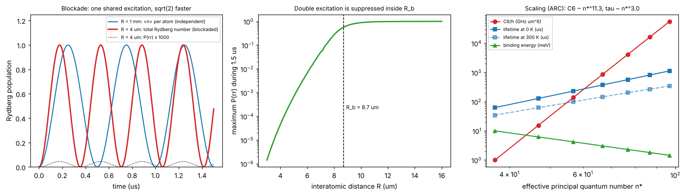

# Rydberg blockade

Theory: [Chapter 10](../../tutorial/10-rydberg.md)

## What you simulate

Atoms with two levels, $|g\rangle$ and the Rydberg state $|r\rangle=|70S_{1/2}\rangle$
of Rb-87, driven resonantly with $\Omega/2\pi=2$ MHz. Pairs in $|rr\rangle$
interact with $V(R)=C_6/R^6$, $C_6/h=862.7$ GHz $\mu$m$^6$ (from ARC):

    H/hbar = (Omega/2) (sigma_x1 + sigma_x2) + (V(R)/hbar) n1 n2

Four numerical experiments:

1. Two atoms 1 mm apart (no interaction) and 4 $\mu$m apart (strong blockade).
2. The residual double-excitation probability versus distance.
3. Clusters of $N=1$ to 4 mutually blockaded atoms: the collective Rabi frequency.
4. Rydberg scaling laws, fitted to ARC values for $40\le n\le100$ that are
   stored in the script (so the lab does not need ARC installed).

Units: time in us, angular frequencies in rad/us, distances in um.

## Run it

Run these commands from the **repository root**, using the environment from the [shared setup](../README.md).

    python -m pip install -r hands-on/requirements.txt
    python hands-on/10-rydberg-blockade/blockade.py

## The code explained

Multi-atom operators are built with Kronecker products,
`op(single, i, N)`, and the Hamiltonian of $N$ atoms with all pairs interacting
is assembled in `H_chain(N, V)`. Time evolution uses the eigendecomposition of
the (time-independent) Hamiltonian, which is exact.

The oscillation frequency is extracted by a least-squares fit of
$A\sin^2(wt/2)$ to the total Rydberg population, starting from the first maximum
of the trace as an initial guess. For the blockade-leakage scaling, the
distance is changed from 4 $\mu$m to $4\times2^{1/6}$ $\mu$m, which exactly halves $V$.

## Expected output

    blockade radius R_b = (C6/hbar Omega)^(1/6) = 8.69 um
    R = 4.00 um: V/h =    210.6 MHz, max P(rr) = 4.57e-05
    R = 4.49 um: V/h =    105.3 MHz, max P(rr) = 1.85e-04 (ratio 4.05, expect 4)
    blockaded pair oscillates at 1.4142 Omega (expect sqrt 2 = 1.4142)
    collective Rabi frequency / Omega: N=1: 1.000, N=2: 1.414, N=3: 1.732, N=4: 2.000
    ARC scaling exponents vs n*: binding -2.00 (theory -2), tau0 3.00 (theory 3), C6 11.32 (theory 11)

Left: far apart, each atom oscillates at $\Omega$; at 4 $\mu$m the pair shares one
excitation and oscillates $\sqrt2$ times faster. Middle: the maximum
double-excitation probability falls steeply inside the blockade radius. Right:
ARC values on log-log axes. The $C_6$ exponent is 11.3 rather than exactly 11,
because the Förster defects of real Rb pair states vary with $n$.

The maximum double excitation at 4 $\mu$m, $4.6\times10^{-5}$, agrees to about 1%
with the perturbative estimate used in Chapter 10,
$\frac12(\Omega/V)^2=\frac12(2/210.6)^2=4.5\times10^{-5}$.

The runner checks the independent-atom limit ($P_{rr}=\sin^4(\Omega t/2)$), the
$\sqrt2$ enhancement, the $(\Omega/V)^2$ scaling of the leakage, the $\sqrt N$
collective frequency, and the scaling exponents of the ARC data.

## Try this

1. Detune the laser by $\Delta=V/2$ at $R=4\ \mu$m. Which state is now resonant with
   $|gg\rangle$ (by absorbing two photons), and at what effective Rabi frequency?
   (Compare with $\Delta=V$, where an atom that is already excited "facilitates"
   the excitation of its neighbour.)
2. Put three atoms on a line with spacing 6 $\mu$m, so nearest neighbours are
   blockaded but the outer pair (12 $\mu$m apart) is not. Which states are
   reachable, and what is the oscillation like?
3. Replace 70S by 50S ($C_6/h=15.4$ GHz $\mu$m$^6$ from the stored table). What
   is the new blockade radius at 2 MHz?
