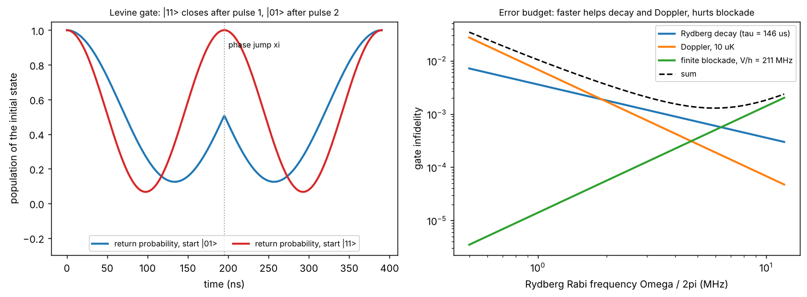

# Rydberg CZ gates and their errors

Theory: [Chapter 11](../../tutorial/11-rydberg-gates.md)

## What you simulate

Two Rb-87 atoms, each with three levels $\{|0\rangle,|1\rangle,|r\rangle\}$, where only
$|1\rangle$ couples to the 70S Rydberg state. The pair Hamiltonian ($\hbar=1$) is

    H = sum_i [ (Omega/2)(e^{-i xi}|r><1| + h.c.) - (Delta + delta_i)|r><r| - (i Gamma/2)|r><r| ]_i + V |rr><rr|

with $\Omega/2\pi=3.5$ MHz, atoms 4 $\mu$m apart ($V/h=211$ MHz), Rydberg decay
rate $\Gamma=1/146\ \mu$s (300 K), and Doppler detunings $\delta_i$.

1. **Levine gate.** Optimise $(\Delta/\Omega,\ \tau\Omega,\ \xi)$ of the two-pulse
   global gate for maximum CZ fidelity with ideal blockade.
2. **Errors.** Add decay, Doppler shifts (10 $\mu$K), or finite blockade, one at a
   time, and compare with simple scaling laws.
3. **Jaksch gate.** Run the addressed $\pi$-$2\pi$-$\pi$ sequence and read off the
   phases.

## Run it

Run these commands from the **repository root**, using the environment from the [shared setup](../README.md).

    python -m pip install -r hands-on/requirements.txt
    python hands-on/11-cz-gate/cz_gate.py

## The code explained

The two-atom Hamiltonian is built with Kronecker products in a 9-dimensional
basis; the computational states $|00\rangle,|01\rangle,|10\rangle,|11\rangle$ sit at
indices 0, 1, 3 and 4. Each pulse is constant, so it is one matrix exponential:

    U = expm(-1j*H(xi, Delta)*tau) @ expm(-1j*H(0, Delta)*tau)

`fidelity_cz` takes the 4 × 4 block $M$ of $U$ on the qubit subspace, removes
single-qubit $Z$ phases read off $M_{01,01}$ and $M_{10,10}$, and computes the
average gate fidelity $F=(|{\rm Tr}(U_{\rm ideal}^\dagger M)|^2+{\rm Tr}(M^\dagger M))/20$.
Leakage out of the subspace lowers ${\rm Tr}(M^\dagger M)$, so it is penalised.

Decay is modelled by the non-Hermitian term $-i\Gamma/2$ on $|r\rangle$: decayed
population simply disappears, which counts as an error (a conservative model;
a real decay may return the atom to a qubit state). To first order this model
gives an infidelity of $\Gamma$ times the mean time spent in $|r\rangle$, computed
by stepping through the ideal gate; that comparison is a consistency check of
the code. The independent physics check is the time $|11\rangle$ spends in
$|r\rangle$: one full detuned cycle of a two-level system with coupling
$\sqrt2\Omega$ per pulse gives exactly $2\tau\,\Omega^2/(2\Omega^2+\Delta^2)$. Doppler shifts are Gaussian random detunings
with rms $k_{\rm eff}\sigma_v$, held constant during each gate and averaged over
600 samples; the two temperatures use independent random draws.

The optimiser is started near the published values. Other starting points can
converge to equivalent solutions, for example the mirror image $\Delta\to-\Delta$,
$\xi\to2\pi-\xi$, or a longer gate with $\tau\Omega\approx5.9$; the published one is the
shortest with $\Delta>0$.

## Expected output

    Levine gate: Delta/Omega = 0.3774, tau*Omega = 4.2927 per pulse, xi = 3.9024 rad
       conditional phase = 1.000001 pi, fidelity (ideal blockade) = 1.0000000001
       total gate time 2 tau = 390 ns = 8.585 / Omega
       time in |r> (us): 00 0.000, 01 0.208, 10 0.208, 11 0.182
    decay (tau = 146.2 us): infidelity 1.022e-03; prediction mean(Gamma T_R) = 1.022e-03
    finite blockade: infidelity at V = 211 MHz: 1.71e-04; at 2V: 4.26e-05 (ratio 4.03)
    Doppler, 10 uK: infidelity 5.56e-04; at T/4 (sigma_v/2): 1.45e-04 (ratio 3.84)
    Jaksch pi-2pi-pi phases / pi for |00>,|01>,|10>,|11>: [ 0.        1.        1.       -0.999999]

(Values within about $10^{-9}$ of 1, and phases of $\pm\pi$, are numerical noise from
the matrix exponential: ideal blockade is modelled by a large but finite
$V=10^7$ rad/us, which keeps the exponential accurately unitary. A phase of
$-\pi$ is the same as $+\pi$.)

Left: probability of staying in the initial state. $|11\rangle$ completes a full
cycle in each pulse; $|01\rangle$ returns only after the phase jump. Right: the
three intrinsic errors versus $\Omega$, extrapolated from the simulated values with
their scaling laws ($1/\Omega$, $1/\Omega^2$, $\Omega^2$), and their sum.

The runner checks eight things: the optimised parameters against the published
values ($\Delta/\Omega=0.377$, $\tau\Omega=4.29$, $\xi=3.90$); the conditional phase and
fidelity with ideal blockade; the full-cycle condition $\sqrt{2+(\Delta/\Omega)^2}\,\tau\Omega=2\pi$;
the time $|11\rangle$ spends in $|r\rangle$ against its analytic value; the decay error
against $\Gamma\overline{T_R}$; the $\sigma_v^2$ and $1/V^2$ scalings; and the Jaksch
truth table.

## Try this

1. Change the laser-phase convention to $e^{+i\xi}|r\rangle\langle1|$ and rerun
   the optimiser. You should find $\xi\approx2.38=2\pi-3.90$.
2. Replace the 300 K lifetime with the 0 K value, 374 $\mu$s. How much does the
   intrinsic error budget improve, and which term now dominates?
3. Give the two atoms slightly different Rabi frequencies (for example a 2%
   intensity mismatch). How large an imbalance can the gate tolerate at the
   $10^{-3}$ level?
