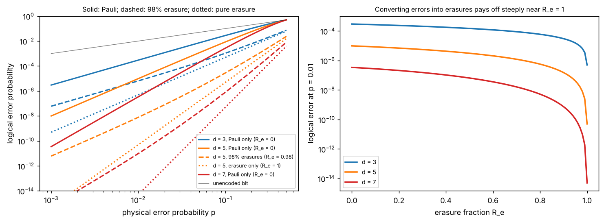

# Erasures versus Pauli errors in a repetition code

Theory: [Chapter 12](../../tutorial/12-architectures.md)

## What you simulate

A logical bit stored in $d$ copies (the repetition code, $d=3,5,7$) and decoded
by majority vote. Each copy independently suffers an error with probability
$p$; a fraction $R_e$ of those errors are **erasures** (the copy is lost and we
know which one, like an empty tweezer in a fluorescence image) and the rest are
**bit flips** at unknown locations. The decoder votes among the non-erased
copies; ties and fully erased blocks are decided by a coin toss.

The exact logical error sums over the numbers of erasures $e$ and flips $f$
with multinomial weights:

$$P_L=\sum_{e,f}\frac{d!}{e!\,f!\,(d-e-f)!}(R_ep)^e\big((1-R_e)p\big)^f(1-p)^{d-e-f}\times\begin{cases}1&2f>d-e\\\tfrac12&2f=d-e\\0&\text{otherwise}\end{cases}$$

Limits: pure flips give $3p^2-2p^3$ for $d=3$ and scale as $p^{(d+1)/2}$; pure
erasures give $p^d/2$.

## Run it

Run these commands from the **repository root**, using the environment from the [shared setup](../README.md).

    python -m pip install -r hands-on/requirements.txt
    python hands-on/12-erasure-code/erasure.py

## The code explained

`p_logical(d, p, Re)` evaluates the double sum above. `p_logical_mc` draws one
uniform random number per copy and classifies it as an erasure
($u<R_ep$), a flip ($R_ep\le u<p$) or no error, then applies the decoder to
400 000 blocks. The effective code distance is the slope
$d\ln P_L/d\ln p$ at small $p$, computed from the exact formula.

## Expected output

     d   model                         P_L MC (p = 0.1)      exact
     3   Pauli only (R_e = 0)          2.788e-02 +/- 2.6e-04   2.800e-02
     3   98% erasures (R_e = 0.98)     1.107e-03 +/- 5.2e-05   1.069e-03
     3   erasure only (R_e = 1)        5.000e-04 +/- 3.5e-05   5.000e-04
     5   Pauli only (R_e = 0)          8.393e-03 +/- 1.5e-04   8.560e-03
     5   98% erasures (R_e = 0.98)     2.250e-05 +/- 8.4e-06   2.830e-05
     5   erasure only (R_e = 1)        5.000e-06 +/- 3.5e-06   5.000e-06
     7   Pauli only (R_e = 0)          2.770e-03 +/- 8.2e-05   2.728e-03
     7   98% erasures (R_e = 0.98)     0.000e+00 +/- 2.5e-06   8.079e-07
     7   erasure only (R_e = 1)        0.000e+00 +/- 2.5e-06   5.000e-08
    small-p slope d ln P_L / d ln p (effective distance):
       d = 3: Pauli 2.00 (expect 2.0), erasure 3.00 (expect 3), 98% erasure 2.01
       d = 5: Pauli 3.00 (expect 3.0), erasure 5.00 (expect 5), 98% erasure 3.04
       d = 7: Pauli 4.00 (expect 4.0), erasure 7.00 (expect 7), 98% erasure 4.10
    at p = 1e-2, d = 5: Pauli 9.85e-06, 98% erasure 7.88e-09, erasure 5.00e-11

For $d=7$ the erasure-dominated failure rates are below what 400 000 shots can
resolve, so the Monte Carlo sees zero failures; the check uses the standard error
floor $\sqrt{1/N}/\sqrt N$ in that case.

Left: logical error versus $p$. Pure erasures (dotted) fall twice as steeply as
Pauli errors (solid). With 98% conversion (dashed), the small residual Pauli rate
eventually sets the slope, but the curve sits orders of magnitude lower. Right:
the logical error at $p=1\%$ versus $R_e$: almost flat until $R_e$ approaches 1,
then a steep drop.

The runner checks the Monte Carlo against the exact sum, the closed-form limits
$3p^2-2p^3$ and $p^d/2$, and the effective distances $(d+1)/2$ and $d$.

## Try this

1. At what erasure fraction does the $d=5$ code reach $10^{-8}$ at $p=1\%$?
2. Add a probability $q$ that an erasure check itself misses an erasure (so
   some erasures become unknown errors). How small must $q$ be to keep most of
   the benefit?
3. Model an atom that is lost and **replaced** by a fresh atom in a random
   state. Is that an erasure, a flip, or neither?
