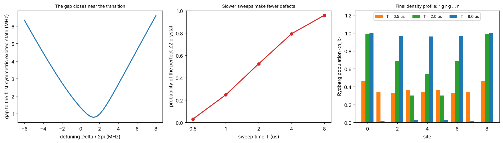

# Analog quantum simulation: preparing an ordered Rydberg crystal

Theory: [Chapter 10](../../tutorial/10-rydberg.md) (and the Landau-Zener section of [Chapter 03](../../tutorial/03-atom-light.md))

## What you simulate

A chain of $N=9$ Rb-87 atoms, 6 $\mu$m apart, each a two-level system
$\{|g\rangle,|r\rangle\}$ with $|r\rangle=|70S\rangle$, evolving under the Rydberg
Hamiltonian of Chapter 10:

    H(t)/hbar = sum_i (Omega(t)/2) sigma_x^i - Delta(t) sum_i n_i + sum_{i<j} V_ij n_i n_j,
    V_ij = C6 / (a |i - j|)^6,  C6/h = 862.7 GHz um^6.

Nearest neighbours are strongly blockaded ($V_1/h=18.5$ MHz, nine times
$\Omega/2\pi=2$ MHz), while next-nearest neighbours barely interact
($V_2/h=0.29$ MHz). For large negative $\Delta$ the ground state has every atom in
$|g\rangle$; for $0<\Delta<V_1$ (in the limit $\Omega\to0$; with $\Omega/2\pi=2$ MHz the crossover is near $\Delta/2\pi\approx1.4$ MHz) it is the **$Z_2$ crystal**
$|r\,g\,r\,g\,r\,g\,r\,g\,r\rangle$, one excitation on every other site.

The protocol, used with 51 atoms by Bernien et al. (2017): start in
$|g\cdots g\rangle$, ramp $\Omega$ on, sweep $\Delta$ from $-2\pi\times6$ MHz to
$+2\pi\times8$ MHz, ramp $\Omega$ off. If the sweep is slow, the adiabatic theorem
keeps the system in its instantaneous ground state and it ends in the crystal.
If it is too fast, it creates defects, because the energy gap to the first
excited state becomes small near the phase transition (the many-body version of
the Landau-Zener problem in Chapter 03).

With $N=9$ the full $2^9=512$-dimensional state can be evolved exactly. You
compare sweep times from 0.5 to 8 $\mu$s.

Units: time in us, angular frequencies in rad/us, lengths in um.

## Run it

Run these commands from the **repository root**, using the environment from the [shared setup](../README.md).

    python -m pip install -r hands-on/requirements.txt
    python hands-on/13-adiabatic-z2/z2_sweep.py

The script takes about one to two minutes. $T$ is the total time: $\Omega$ is ramped
on and off during the first and last 10% of $T$, and $\Delta$ is swept linearly during
the remaining $0.8T$.

## The code explained

Each basis state is an integer whose binary digits are the occupations
$n_i$. The interaction and detuning terms are diagonal in this basis, and
$\sum_i\sigma_x^i$ flips one bit at a time, so the Hamiltonian is a sparse matrix:

    H(Om, De) = 0.5 * Om * SX + diags(-De * n_tot + V_diag)

The time evolution uses 400 piecewise-constant steps with SciPy's
`expm_multiply`, which applies a matrix exponential to a vector without forming
the full matrix.

Because the starting state $|g\cdots g\rangle$ and the Hamiltonian are both
symmetric under reflecting the chain, only reflection-symmetric excited states
can be reached. The script therefore computes the energy gap within that
symmetric sector along the sweep; this is the gap that controls adiabaticity.
(Here the first excited state is itself reflection-symmetric, so the
symmetric-sector gap equals the full gap; the restriction matters for other $N$
or geometries.)

## Expected output

    V1/h = 18.49 MHz, V2/h = 0.289 MHz
    blockade-allowed configurations: 89 (Fibonacci F(N+2) = 89)
    classical ground state at Delta_end: 101010101 (Z2 = 101010101)
    minimum gap in the symmetric sector: 0.788 MHz at Delta/2pi = 1.35 MHz
     sweep time (us)   P(Z2)   P(adjacent pair)   <n_Rydberg>
          0.50        0.030       3.08e-02          3.324
          1.00        0.247       4.43e-04          4.109
          2.00        0.524       2.02e-04          4.521
          4.00        0.793       5.22e-05          4.793
          8.00        0.959       8.83e-07          4.959

(The adjacent-pair probabilities below about $10^{-5}$ are not converged in the
number of time steps; read them as "less than $10^{-5}$". $P(Z_2)$ is converged.)

Left: the gap to the first symmetric excited state shrinks to 0.79 MHz near
$\Delta/2\pi\approx1.4$ MHz, the finite-size remnant of the phase transition. Middle:
the probability of the perfect crystal rises from 3% for a 0.5 $\mu$s sweep to 96%
for 8 $\mu$s. Right: the Rydberg population on each site. Slow sweeps give the
alternating pattern $r\,g\,r\,g\ldots$; fast sweeps leave a disordered, partly
excited chain. The edges order first because the end atoms have only one
neighbour.

The 0.5 $\mu$s sweep also shows a 3% probability of two *adjacent* excitations:
its 50 ns ramps of $\Omega$ are so fast that their spectrum reaches
$V_1-\Delta\approx10$ MHz, the energy cost of exciting a neighbour at the end of the
sweep, so the blockade is no longer perfect. For slower sweeps this
leakage is below $10^{-3}$.

The runner checks four things: the number of configurations allowed by the
nearest-neighbour blockade is the Fibonacci number $F(N+2)=89$ (a classic
counting result); the classical ground state at the end of the sweep is the
$Z_2$ crystal; the blockade holds (adjacent-pair probability below 1%) for sweeps
of 1 $\mu$s or longer; and the crystal probability increases with sweep time and
exceeds 0.9 for the slowest sweep.

## Try this

1. Estimate a Landau-Zener time scale from the minimum gap,
   $T\sim\Delta_{\rm range}/\Delta_{\min}^2$ (in angular units). With
   $\Delta_{\rm range}=2\pi\times14$ MHz and $\Delta_{\min}=2\pi\times0.79$ MHz this gives
   about 3.6 $\mu$s for the linear part of the sweep. Is 8 $\mu$s "slow"?
2. Reduce the spacing to 4.5 $\mu$m ($V_2=V_1/64\approx1.6$ MHz). Is $Z_2$ still the
   classical ground state at $\Delta_{\rm end}$? Compare its four next-nearest-neighbour
   bonds (about 6.5 MHz) with the 8 MHz gained per excitation. Then try 4.0 $\mu$m
   ($V_2\approx3.3$ MHz): which state wins now, and does the sweep reach it?
3. Change $N$ to 10 (even). Both end atoms want to be excited, so a perfect
   $r\,g\,r\,g\ldots$ pattern no longer fits: the classical ground state contains
   one domain wall ($\ldots r\,g\,g\,r\ldots$). Which configurations does the slow
   sweep produce, and where is the wall?
