# 01 · Introduction: Why Neutral Atoms

> **Study companion:** [what to run and chapter checkpoints](learning-path.md) · [notation and reference numbers](00-notation.md) · [paper map](paper-map.md)

A neutral-atom quantum computer stores each qubit in a single atom, held in place by a tightly focused laser beam (an **optical tweezer**) inside an ultra-high-vacuum glass cell. Nothing about the qubit is fabricated: every rubidium-87 atom is identical to every other one, so there is no device-to-device spread to calibrate away. The engineering challenge is the opposite of chip building. Instead of making qubits, you have to **catch** them: slow atoms from hundreds of metres per second to a few centimetres per second, cool them to microkelvin temperatures, trap them one by one, and arrange them into a pattern. Only then can you start computing.

This chapter gives you the big picture: what the experimental cycle looks like, why atoms make good qubits, which criteria a quantum computer has to meet and how atoms meet them, and how the rest of the course is organised. Every idea here is developed properly in a later chapter.

## The experimental cycle in one picture

![Circular flow chart of eight steps: hot vapour of rubidium atoms at about 300 m/s; a magneto-optical trap cooling about ten million atoms to about 100 microkelvin; loading of tweezers where light-assisted collisions leave zero or one atom with about 50 percent probability each; a fluorescence image showing which sites are full; rearrangement by moving tweezers into a defect-free array; cooling and optical pumping to state 0; computation with single-qubit and Rydberg gates; readout by pushing out one state and imaging again. The cycle repeats about once per second](figures/01-experimental-cycle.png)

*One cycle of a tweezer-array experiment. Steps 1 to 3 are laser cooling and trapping (Chapters 04 to 07); steps 4 and 5 build the array (Chapter 08); steps 6 to 8 are the quantum computer proper (Chapters 09 to 12). The numbers are typical orders of magnitude, not those of a particular machine.*

Read the cycle as a story about **energy scales**. The atoms start as a room-temperature vapour. At 300 K the root-mean-square speed of a Rb-87 atom is

$$v_{\rm rms}=\sqrt{\frac{3k_BT}{m}}=\sqrt{\frac{3\,(1.381\times10^{-23}\ {\rm J/K})(300\ {\rm K})}{1.443\times10^{-25}\ {\rm kg}}}\approx293\ {\rm m/s}.$$

An optical tweezer is a potential well about $k_B\times1$ mK deep. An atom can be trapped only if its kinetic energy is well below that, so the atoms must first be cooled by a factor of roughly $10^5$ in temperature. Laser light does this: each absorbed photon carries momentum $\hbar k$, and by arranging for atoms to absorb mostly photons that oppose their motion, a laser beam acts like friction (Chapters 04 and 05). A **magneto-optical trap (MOT)** adds a magnetic field gradient so that the friction comes with a restoring force (Chapter 06), collecting millions of atoms at about $100\ \mu$K in a cloud a millimetre across.

From that cloud, an array of tweezers picks up atoms. A surprising piece of physics now helps: when two atoms sit in the same tiny trap, laser light makes them collide and both are lost. Each tweezer ends up holding either zero or one atom, with roughly even odds (Chapter 08). A camera photographs the array, a computer finds the empty sites, and a second set of movable tweezers drags atoms into a perfect, defect-free pattern. Then the quantum computation starts.

## Why atoms make good qubits

| Property | What it buys you | Where you learn it |
|---|---|---|
| **Identical by nature** | every qubit has the same frequencies; no fabrication spread | Ch 02 |
| **Weakly coupled to the environment** | a neutral atom in its ground state barely feels electric fields or its neighbours, so hyperfine qubits keep their phase for seconds | Ch 09 |
| **Interactions you can switch on** | exciting an atom to a high-lying **Rydberg** state makes it interact strongly with atoms micrometres away; de-exciting switches the interaction off again | Ch 10 to 11 |
| **Optically reconfigurable** | tweezers are just light, so the layout is software: atoms can be moved mid-computation to connect any pair | Ch 08, 12 |
| **Scalable in number** | thousands of tweezers can be made from one laser with holograms or acousto-optic deflectors | Ch 08 |

The second and third properties pull in opposite directions, and reconciling them is the central idea of the platform. A good memory wants an atom that ignores everything; a good gate wants atoms that interact strongly. Neutral atoms do both by changing state: in the ground state the van der Waals interaction between two atoms $5\ \mu$m apart is utterly negligible, while in the $70S$ Rydberg state the same pair interacts with energy

$$\frac{V}{h}=\frac{C_6/h}{R^6}=\frac{863\ {\rm GHz}\,\mu{\rm m}^6}{(5\ \mu{\rm m})^6}=\frac{863\times10^3\ {\rm MHz}}{15\,625}\approx55\ {\rm MHz},$$

far larger than the few-MHz laser coupling used to drive the atoms. That mismatch is the **Rydberg blockade**, and it is what makes entangling gates possible (Chapter 10).

> **Intuition aside.** Think of each atom as a person in a library. In the ground state everyone whispers: nobody hears anyone else, so private notes (qubit phases) survive for a long time. Exciting two people to Rydberg states is like handing them megaphones for a microsecond: they can no longer ignore each other, and that brief, controlled conversation is the entangling gate.

## Fourteen orders of magnitude

*The frequency (or energy, via $E=hf$) scales in one experiment, computed from the reference data in the [notation page](00-notation.md). Much of atomic physics is the art of using a fast scale to control a slow one: optical photons at hundreds of THz set up a trap whose vibrations are at 100 kHz.*

Keep this ladder in mind. Many approximations in this course work because two scales are far apart. The rotating-wave approximation (Chapter 03) needs the laser coupling to be much smaller than the optical frequency; the dipole trap (Chapter 07) needs the laser to be detuned from resonance by much more than the linewidth; the hyperfine qubit is protected because 6.8 GHz is tiny compared with optical energies but huge compared with the trap vibration frequency.

## The DiVincenzo criteria, atom by atom

DiVincenzo listed five requirements for a quantum computer (plus two for quantum communication). Here is how neutral atoms meet them.

| Criterion | Neutral-atom answer | Main limitation today |
|---|---|---|
| 1. Scalable, well-characterised qubits | two hyperfine ground states of an alkali atom (or nuclear-spin states of an alkaline-earth atom) | loading is probabilistic; the array must be assembled each cycle |
| 2. Initialisation to a simple state | optical pumping prepares one magnetic sublevel with high probability | imperfect pumping, residual atom temperature |
| 3. Coherence times much longer than gate times | hyperfine coherence of milliseconds to seconds versus gates of microseconds | differential light shifts, magnetic noise, Rydberg decay *during* gates |
| 4. A universal set of gates | microwave or Raman single-qubit rotations; Rydberg-blockade CZ gates | two-qubit fidelity, laser noise |
| 5. Qubit-specific measurement | fluorescence imaging of each tweezer | standard imaging ejects or heats the atom; it is slow (milliseconds) |

The last column is the honest part. Most of Chapters 08 to 12 is about those limitations and the clever ways experiments now work around them.

## How atoms compare with other platforms

| | Neutral atoms | Trapped ions | Superconducting circuits |
|---|---|---|---|
| Qubit | internal states of a neutral atom | internal states of a charged atom | quantised modes of an electrical circuit |
| Held by | light (optical tweezers) | electric fields (Paul trap) | wiring on a chip |
| Interaction | Rydberg dipole-dipole, short range, switched by laser | shared motion via Coulomb force | capacitive or inductive coupling |
| Connectivity | reconfigurable by moving atoms | all-to-all within a chain | fixed nearest-neighbour layout |
| Natural strength | qubit number, identical qubits | gate fidelity, coherence | gate speed |

All three platforms improve rapidly; treat this table as a description of *mechanisms*, not a scoreboard. The useful lesson is that the neutral-atom platform trades slow cycle times (atoms must be reloaded and the camera is slow) for very large, identical, rearrangeable arrays.

## A short history

- **1975 to 1985: the idea and first demonstrations of laser cooling.** Proposals to cool atoms and ions with light (Hänsch and Schawlow; Wineland and Dehmelt, 1975) were followed by laser deceleration of an atomic beam (Phillips and Metcalf, 1982) and three-dimensional "optical molasses" (Chu and co-workers, 1985).
- **1987 to 1989: the MOT and the sub-Doppler surprise.** The magneto-optical trap (Raab et al., 1987) became the workhorse source of cold atoms. Atoms in molasses turned out to be colder than the theory of the day allowed (Lett et al., 1988), and polarization-gradient cooling explained why (Dalibard and Cohen-Tannoudji, 1989).
- **1997: Nobel Prize** to Chu, Cohen-Tannoudji and Phillips for laser cooling and trapping.
- **2000 to 2001: the quantum-computing blueprint.** Jaksch et al. proposed fast Rydberg gates between neutral atoms; Lukin et al. introduced the dipole blockade; Schlosser et al. trapped single atoms in a microscopic dipole trap.
- **2009 to 2010: blockade and first gates** between two individual atoms (Urban et al.; Gaëtan et al.; Wilk et al.; Isenhower et al.).
- **2016: atom-by-atom assembly** of defect-free arrays by rearrangement (Endres et al.; Barredo et al.).
- **2017 to 2021: programmable quantum simulators** with tens to hundreds of Rydberg atoms (Bernien et al.; Ebadi et al.; Scholl et al.).
- **2023 to 2025: toward fault tolerance.** Parallel CZ gates at 99.5% fidelity (Evered et al.), a logical-qubit processor based on moving atoms (Bluvstein et al.), arrays of more than 6000 trapped atoms (Manetsch et al.) and continuously reloaded arrays of thousands of qubits (Chiu et al.).

Full references are in the [reading list](../reading-list/README.md); Chapter 12 returns to the most recent results.

## Worked example: how hard is it to stop an atom? (illustrative numbers)

All values from the [reference table](00-notation.md).

| Symbol | Meaning | Value |
|---|---|---|
| $v_0$ | initial speed (fast atom from the vapour) | 300 m/s |
| $v_r=\hbar k/m$ | velocity change per photon (D2, 780 nm) | 5.885 mm/s |
| $\Gamma/2$ | maximum photon scattering rate | $1.906\times10^7\ {\rm s^{-1}}$ |
| $N$ | photons needed to stop the atom | **51 000** (computed) |
| $t_{\rm stop}$ | shortest stopping time | **2.7 ms** (computed) |
| $L_{\rm stop}$ | shortest stopping distance | **0.40 m** (computed) |

**Step 1: number of photons.** Each absorbed photon changes the velocity by $v_r$. The emitted photons go in random directions and average to zero, so $N=v_0/v_r=300/(5.885\times10^{-3})\approx5.1\times10^4$.

**Step 2: time.** An atom cannot scatter faster than $\Gamma/2$: in a very strong beam it spends half its time in the excited state, and the excited state decays at rate $\Gamma=2\pi\times6.0666\ {\rm MHz}=3.81\times10^7\ {\rm s^{-1}}$. So $t_{\rm stop}\ge N/(\Gamma/2)=5.1\times10^4/1.906\times10^7=2.7$ ms.

**Step 3: distance.** The maximum deceleration is $a_{\max}=v_r\,\Gamma/2=1.12\times10^5\ {\rm m/s^2}$, more than ten thousand times gravity. Stopping from $v_0$ takes $L=v_0^2/2a_{\max}=0.40$ m. Real slowers run at a fraction of $a_{\max}$ and are longer (Chapter 05).

**Step 4: the end point.** After slowing and cooling, a typical atom moves at a few cm/s: at $10\ \mu$K the one-dimensional rms velocity is $\sqrt{k_BT/m}=3.1$ cm/s, about five recoil velocities. The whole journey spans a factor of $10^4$ in velocity and $3\times10^7$ in temperature.

**Takeaway:** a single photon barely nudges an atom, but an atom can scatter ten million photons per second. That enormous rate is what makes light such a strong tool for controlling atoms.

## Course map

```mermaid
flowchart LR
    subgraph P1["Part I: atoms and light (Metcalf and van der Straten)"]
        C2["02 Atomic structure"] --> C3["03 Two-level atom"] --> C4["04 Optical forces"]
        C4 --> C5["05 Slowing and Doppler cooling"] --> C6["06 Sub-Doppler cooling and MOT"]
    end
    subgraph P2["Part II: single atoms in tweezers"]
        C7["07 Optical tweezers"] --> C8["08 Loading, imaging, arrays"] --> C9["09 Qubits and coherence"]
    end
    subgraph P3["Part III: computing with Rydberg atoms"]
        C10["10 Rydberg atoms and blockade"] --> C11["11 Entangling gates"] --> C12["12 Toward fault tolerance"]
    end
    C6 --> C7
    C9 --> C10
```

Part I follows the logic of the course's primary text, Metcalf and van der Straten's review *Laser cooling and trapping of atoms*: optical forces first, then slowing and molasses, then the multilevel physics behind sub-Doppler cooling and magneto-optical trapping. Part II zooms in on a single atom in a single trap and then on arrays. Part III adds interactions.

## Common pitfalls

- **"Laser cooling heats atoms because light carries energy."** Absorbed photons do add energy, but when the laser is tuned slightly below resonance, an atom preferentially absorbs photons that oppose its motion and re-emits slightly more energetic ones. The difference comes out of the atom's kinetic energy (Chapter 05).
- **"A tweezer holds an atom by pushing on it."** A red-detuned tweezer attracts the atom toward the intensity maximum through the dipole force; it is a potential well, not a stream of momentum kicks. Photon scattering in the trap is a nuisance that heats the atom (Chapters 04 and 07).
- **"Atoms are identical, so experiments need no calibration."** The atoms are identical; the light fields that address them are not. Intensity variations across an array, stray magnetic fields and atomic motion all have to be calibrated.
- **"Ground-state atoms do not interact at all."** They do, weakly. Two atoms in the same tweezer collide strongly enough that light-assisted collisions eject pairs, which is exactly what makes single-atom loading work (Chapter 08). Atoms in *separate* tweezers a few micrometres apart are, for practical purposes, non-interacting until excited to Rydberg states.

## Key takeaways

- A neutral-atom qubit is a single atom in an optical tweezer; the qubit lives in two long-lived internal states.
- Atoms must first be cooled by roughly five orders of magnitude in temperature. Laser cooling does this by scattering tens of thousands of photons per atom.
- Ground-state atoms barely interact, which protects stored information; Rydberg excitation switches on interactions of tens of MHz at micrometre distances, which enables gates.
- Arrays are assembled each cycle: stochastic loading, imaging, then rearrangement.
- The five DiVincenzo criteria map naturally onto atoms; the hard parts are gate fidelity, atom loss, and slow cycle times.

## Go deeper

- H. J. Metcalf and P. van der Straten, *Laser cooling and trapping of atoms*, J. Opt. Soc. Am. B 20, 887 (2003), [Utrecht preprint](https://webspace.science.uu.nl/~strat102/preprint/handpubl.pdf), [doi:10.1364/JOSAB.20.000887](https://doi.org/10.1364/JOSAB.20.000887). The primary text for Part I of this course.
- D. P. DiVincenzo, *The physical implementation of quantum computation*, Fortschr. Phys. 48, 771 (2000), [arXiv:quant-ph/0002077](https://arxiv.org/abs/quant-ph/0002077). The criteria in the table above.
- L. Henriet et al., *Quantum computing with neutral atoms*, Quantum 4, 327 (2020), [arXiv:2006.12326](https://arxiv.org/abs/2006.12326). A readable overview of the platform from trapping to algorithms.
- A. M. Kaufman and K.-K. Ni, *Quantum science with optical tweezer arrays of ultracold atoms and molecules*, Nat. Phys. 17, 1324 (2021), [arXiv:2109.10087](https://arxiv.org/abs/2109.10087). A short review of tweezer arrays specifically.
- A. Browaeys and T. Lahaye, *Many-body physics with individually controlled Rydberg atoms*, Nat. Phys. 16, 132 (2020), [arXiv:2002.07413](https://arxiv.org/abs/2002.07413). The Rydberg side of the story.

---

← Back to [project README](../README.md) · [Tutorial index](./README.md)
